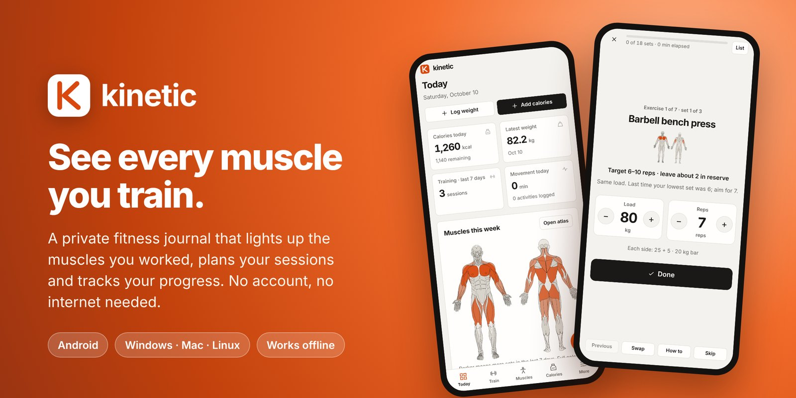
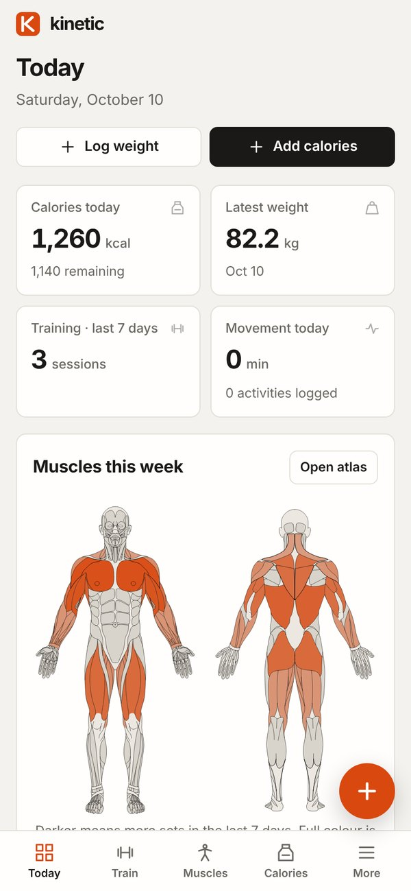
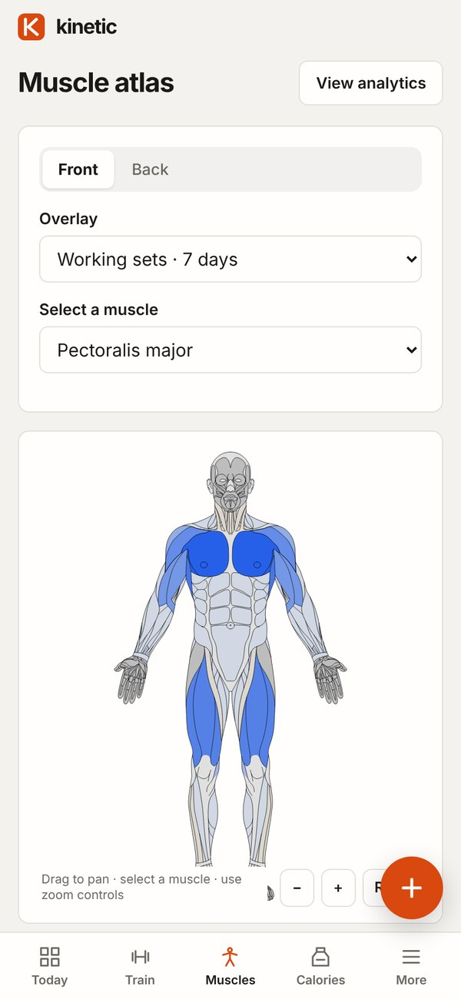
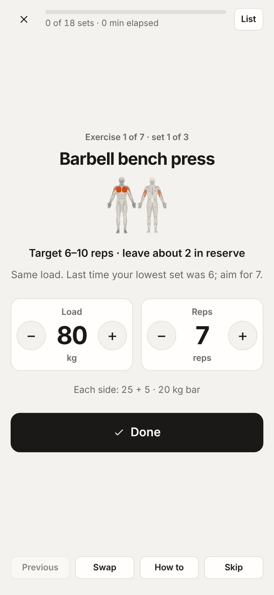
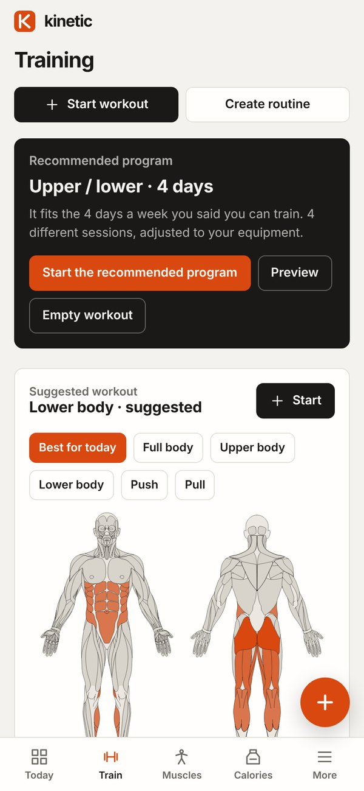
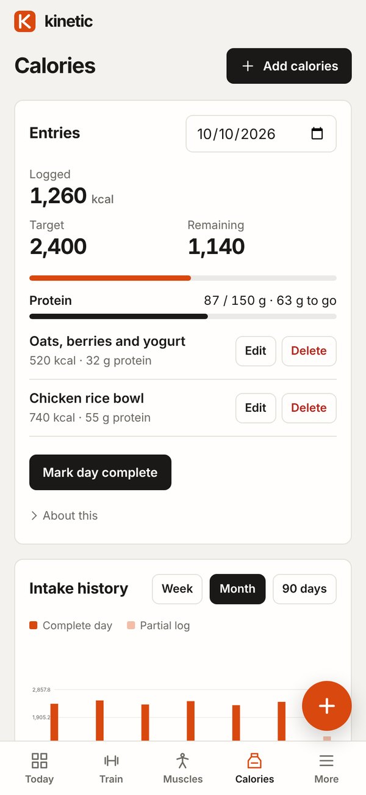
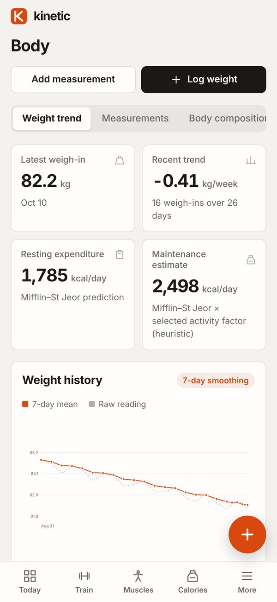
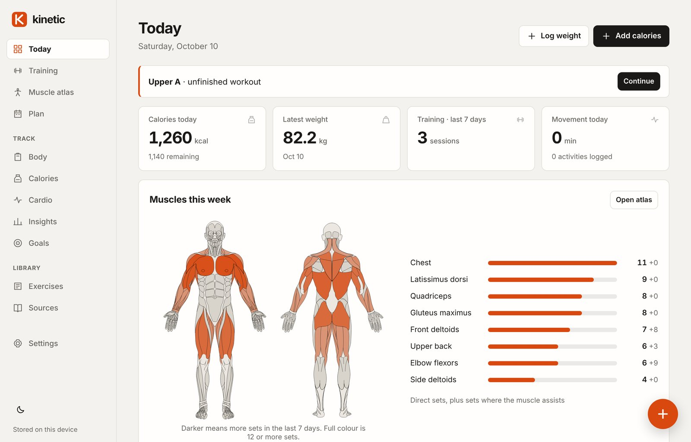

  

  
  &nbsp;
  

  
  
  

**Kinetic** is a fitness journal that shows you, on a real anatomical map, exactly which muscles you have trained. It plans your workouts around the equipment you have, coaches you one set at a time, and tracks calories, protein, weight and progress photos. Everything stays on your device: no sign-up, no ads, no internet needed.

## A look inside

<table>
  <tr>
    <td align="center" width="33%"> <b>Today</b> Your week at a glance, with every muscle you trained lit up.</td>
    <td align="center" width="33%"> <b>Muscle atlas</b> Tap any muscle. See working sets, recent activity and what trains it.</td>
    <td align="center" width="33%"> <b>Focus mode</b> One set at a time, with targets and the plates to load on each side.</td>
  </tr>
  <tr>
    <td align="center"> <b>Programs</b> Seven science-based programs, adjusted to your equipment.</td>
    <td align="center"> <b>Calories and protein</b> Quick totals, a protein target and an honest intake history.</td>
    <td align="center"> <b>Body</b> Weight trend, measurements, body fat and progress photos.</td>
  </tr>
</table>

 The same app on a computer.

## What it does

- 💪 **Muscle map everywhere.** Today, every workout, every program session and every exercise shows the muscles it works, using open-source anatomical artwork.
- 🏋️ **108 exercises** with how-to notes, and swaps when you are missing a piece of equipment.
- 📋 **Programs and suggested workouts** built from your training days, goal, experience and the last 7 days of your log.
- 🎯 **Focus mode** with loads prefilled from last time, a rest timer and plate maths for barbell lifts.
- 🍽️ **Calories and protein** logged in seconds from the **+** button on any page.
- 📈 **Progress**: weight trend, measurements, body fat, goals with projections, and a before-and-after photo slider.
- 🔒 **Private by design**: no account, no tracking, optional passphrase lock, and full backups you control.

## Install on your phone (Android)

1. On your phone, tap **Download for Android** above. The file `Kinetic.apk` downloads.
2. Open the downloaded file. The first time, Android asks whether your browser (or Files app) may install apps. Tap **Settings**, turn on **Allow from this source**, then go back.
3. Tap **Install**, then **Open**.

To update later, download and install the newer file the same way. Your journal is kept. More detail, including what differs from the computer version, is in [`android/README.md`](android/README.md).

## Run it on your computer

1. Install **Node.js** (the "LTS" version) from [nodejs.org](https://nodejs.org) if you don't have it.
2. [**Download Kinetic as a ZIP**](https://github.com/Subterfugus/kinetic/archive/refs/heads/main.zip) and unzip it.
3. Start it:
   - **Windows:** double-click **Start-Kinetic.cmd** in the unzipped folder.
   - **Mac or Linux:** open a terminal in the folder and type `npm start`.
4. Open **http://127.0.0.1:4173** in your browser. Keep the small server window open while you use it.

Opening `index.html` directly does not work, because the app needs to be served to store your journal and work offline.

## Get started

On a new, empty journal, a short setup asks for your units, equipment and training days, then offers the recommended program. Run it again, or take the welcome tour, from **Settings → About**. The **+** button in the corner of every page logs calories, weight, a set, a walk or run, or sleep.

1. Set your optional profile, units, equipment and goal in Settings. Energy estimates require the published equation inputs; the calorie target is separately editable. The equipment list decides which exercises programs and substitutions can use.
2. Start a workout, choose exercises, and mark completed sets. Focus mode opens when a workout starts and shows one set at a time, with plates per side for barbell lifts; it can be switched off with the option on the Training page. Loads are prefilled from your last session of each movement, and completing a set starts the rest timer (both the automatic start and the beep can be switched off in the workout). A unilateral set row represents a completed left/right pair. Keep load conventions consistent.
3. Plan a program. Plan recommends one of seven programs from your training days, goal and experience, and shows each session adjusted to your equipment: an exercise you cannot use is replaced by the closest available substitute, and sets are added where a muscle would otherwise lose work. Starting a program fills each session's load targets when you begin it. In a workout, Swap changes one exercise, and Equipment today changes the current workout only. Recovery weeks are suggested when lifts stall and start only when you choose them.
4. Explore the Muscle atlas, now in the main menu and the bottom bar as **Muscles**. The same muscle map appears on Today (everything trained in the last 7 days), on every workout, suggested workout and program session, in focus mode and on each exercise. The same exercise relationships drive highlights, workout history and muscle-group set counts. Training also suggests a workout built from the last 7 days of your log, your equipment and your experience. Choose a focus (best for today, full body, upper, lower, push or pull) or ask for different exercises.
5. Log calories manually, with optional grams of protein. Set an optional daily protein target to see a protein meter next to the calorie meter. Mark a day complete when its intake is fully recorded; incomplete days are excluded from intake averages and maintenance calibration.
6. Add weigh-ins, measurements, method-identified body-fat readings, photos, cardio, or optional wellbeing records. The photo tab of the Body page takes photos with a ghost of the previous photo of the same view, a timer, a before-and-after slider and a time-lapse. Track → Goals holds lift, body-weight, run-time and weekly-habit goals, with progress and a projection range.
7. Export a full backup regularly; Overview reminds you when this device has no backup from the last 14 days. Restore validates a backup before replacing the journal.

## Privacy and backups

Records and photos stay in IndexedDB on the current browser and origin, or inside the Android app's own storage. No health records are sent to a server, and no analytics or external data API is used. The photo studio uses the camera only while its dialog is open. To move between browsers, devices or origins, export and restore a full backup.

The optional passphrase vault encrypts the journal and photos at rest. There is no passphrase recovery service. An unlocked browser session can read its records. Full backups are encrypted when the vault is enabled; CSV exports remain readable. Browser clearing, device loss and storage eviction can remove records, so downloaded backups are essential. The app asks the browser to protect its storage from automatic eviction; Settings shows whether that was granted. Timer, sound, backup-reminder, focus-mode and bar-weight preferences are stored per device and are not part of the journal or its backups. Programs and goals are part of the journal and its backups.

## Scientific interpretation and scope

The app labels population equations, observational trends and product heuristics. Muscle counts represent recorded set exposure, not measured activation or biological recovery; program volume is a planned count that uses the same primary and secondary convention. Body-fat and energy values retain uncertainty. Goal projections are ranges based on recent trends, not confidence intervals or promised dates. Progression suggestions require qualifying records and are never applied automatically; program load targets are filled into a workout when it starts and can be changed before logging. Programs are general templates for generally healthy adults and do not account for injuries or medical conditions. Their rules, values and certainty are listed in `scientific-methodology.md`.

Front/back anatomy preserves licensed source geometry. There is no side view: the licensed map comes only in front and back, and the earlier historical side plate was removed in 1.7 because it did not match. Wearable integrations, a bespoke 3D model and clinical injury rehabilitation are outside this release. The local planner exposes preferences/limitations but does not interpret injuries. There are no food databases, nutrition services or fabricated journal records.

See `scientific-methodology.md`, `asset-provenance.md`, `verification.md`, `architecture.md`, and `info.md` for methods, sources, testing, architecture and the change log.

## Development

Current release: 1.8.0.

Native JavaScript modules; no runtime package dependencies or build step. `dist/` is the complete static application. Node.js is used only for the local server and checks.

The Android app in `android/` is a Capacitor shell around `dist/`; `dist/native.js` holds the few Android-only bridges (file saving, screen wake, system bars, back button) and is inert in a browser. Capacitor is a development dependency only. `.github/workflows/android.yml` builds the APK. See `android/README.md`.

Run `npm test` (76 tests) for scientific, program, goal, validation and encryption behavior; `npm run check` for exercise/anatomy/source/offline-asset integrity. The service worker serves cached files first and refreshes them in the background, so a changed file appears on the second load. After changing cached assets, bump the service-worker cache version and verify offline behavior.
